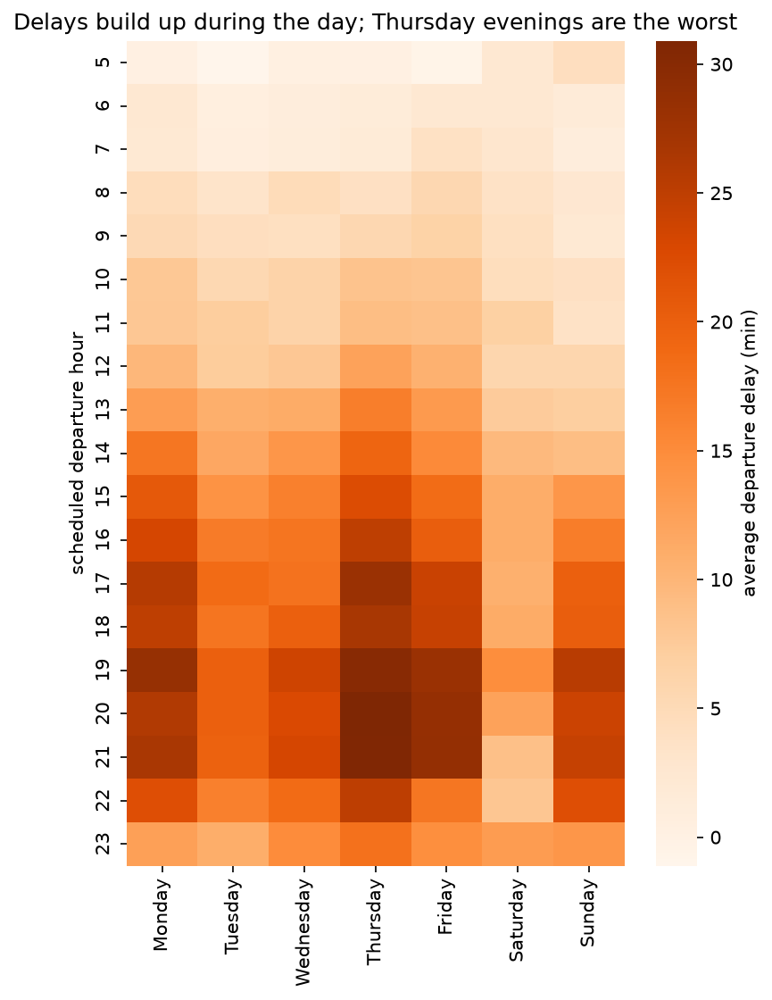

# What drives flight delays from New York airports?

Exploratory analysis of the **336,776 flights** that departed from New York City airports (JFK, LGA, EWR) in 2013, combining flight, airline and hourly weather data to understand **when, where and why** flights get delayed.




## Key findings

1. **Delays build up during the day.** Morning flights leave almost on time, but average delays grow towards the evening and peak on Thursdays around 8 p.m. (≈31 minutes), likely because delays are carried from one flight to the next.
2. **Airlines differ widely, but sample size matters.** Frontier, AirTran and ExpressJet arrive more than 15 minutes late on average, over twice the overall mean (≈7 minutes); ExpressJet, with over 50,000 flights, affects by far the most passengers.
3. **Rain is linked to much longer delays, even comparing like with like.** Rain nearly triples average departure delays overall (31 vs. 11 minutes) and still nearly doubles them within the same month and time of day (July, 3-8 p.m.: 68 vs. 35 minutes).

The full analysis, with charts and caveats, is in [`notebooks/report.ipynb`](notebooks/report.ipynb).

## Limitations

- **Associations, not causal effects.** This is observational data. The weather analysis controls for month and time of day, but other factors (airport, airline, destination weather) could still explain part of the differences.
- **Missing outcomes.** Cancelled (≈2.5%) and diverted flights have no arrival delay and are excluded from the averages, so the figures understate the real disruption, especially on bad-weather days.
- **Small samples.** Some airlines operate only a few hundred flights, and the rainy-evening comparison rests on 11 days of rain, so those estimates are uncertain.
- **Scope.** One year (2013), one city and departures only. Patterns may have changed since then; some of these airlines no longer exist.

## Data

[nycflights13](https://github.com/tidyverse/nycflights13) contains all domestic flights that departed in 2013 from New York City's airports: JFK, LaGuardia and Newark. There are tables of airlines and hourly weather at each origin airport as well. About 2.5% of flights were cancelled; delays are measured in minutes and negative values mean early departures or arrivals. The data is downloaded automatically on first run (not stored in this repository).

## How to reproduce

```bash
git clone https://github.com/VictorRomeroHerrerosdeTejada/nyc-flights-delays.git
cd nyc-flights-delays
conda env create -f environment.yml
conda activate nyc-flights
jupyter lab notebooks/report.ipynb
```

## Repository structure

```
├── notebooks/
│   └── report.ipynb      # full analysis, from question to conclusions
├── src/
│   └── flights.py        # data loading, feature engineering and plotting helpers
├── figures/              # charts used in this README
├── environment.yml
└── README.md
```

## Next steps

- **Test the knock-on hypothesis directly.** Use each aircraft's tail number (`tailnum`) to follow its flights through the day and measure how much of a delay is inherited from its previous flight.
- **Estimate the weather effect with more controls**, for example a regression that includes month, hour, airport, airline and destination weather at the same time.
- **Predict delays.** Train a model that predicts whether a flight will leave more than 15 minutes late from information known in advance (schedule, airline, weather forecast), validated on later months than those used for training.

---
*Author: Víctor Romero Herreros de Tejada · [LinkedIn](https://www.linkedin.com/in/v%C3%ADctor-romero-herreros-de-tejada-18092a24b)*